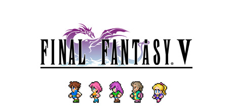

**Final Fantasy V features the legendary Job System where every character can master any of 26 job classes and mix abilities across mastered jobs. Follow Bartz and friends protecting the world's Crystals from the sorcerer Exdeath in a lighter but mechanically rich adventure.**

---

## 📖 About

Final Fantasy V features the legendary Job System where every character can master any of 26 job classes and mix abilities across mastered jobs. Follow Bartz and friends protecting the world's Crystals from the sorcerer Exdeath in a lighter but mechanically rich adventure.

## ⚠️ Problems Without Trainer

| Problem | Status |
|---------|--------|
| **Job Master Grind** — Fully mastering all jobs for all characters requires enormous AP grinding | ✅ Solved |
| **Ability Mixing** — Finding optimal cross-job ability combinations requires system mastery | ✅ Solved |
| **Neo Exdeath** — Final boss can hit multiple party members simultaneously with brutal attacks | ✅ Solved |
| **Omega and Shinryu** — Optional superbosses are some of the hardest in JRPG history | ✅ Solved |

## ✅ Solution

The **Final Fantasy V Trainer** solves all these issues by giving you complete control over the game.

## 🎯 Full Feature List

- Unlimited Resources
- God Mode / Invincibility
- Instant Skill Cooldown
- One-Hit Kill
- Freeze Game Timer
- Unlock All Items & Achievements
- Custom Speed Multiplier
- Save State Anywhere

## 🚀 Quick Start

1. **Disable Windows Defender** temporarily (trainer may trigger false positive)
2. Download the trainer from the button above
3. Launch Final Fantasy V
4. Run the trainer as Administrator
5. Activate desired cheats with hotkeys

## 💎 Free vs Paid

| Feature | Free | Pro |
|---------|------|-----|
| Basic God Mode | ✅ | ✅ |
| Unlimited Resources | ✅ | ✅ |
| All Advanced Cheats | ❌ | ✅ |
| Auto-Updates | ❌ | ✅ |
| Priority Support | ❌ | ✅ |

## 💻 Requirements

- Windows 10/11 (64-bit)
- Final Fantasy V (any version)
- .NET Framework 4.8+
- DirectX 11+

## 🍎 macOS

macOS users can use our alternative tool:

## ⚖️ Legal

This trainer is for educational and single-player use only. Use responsibly.

---

